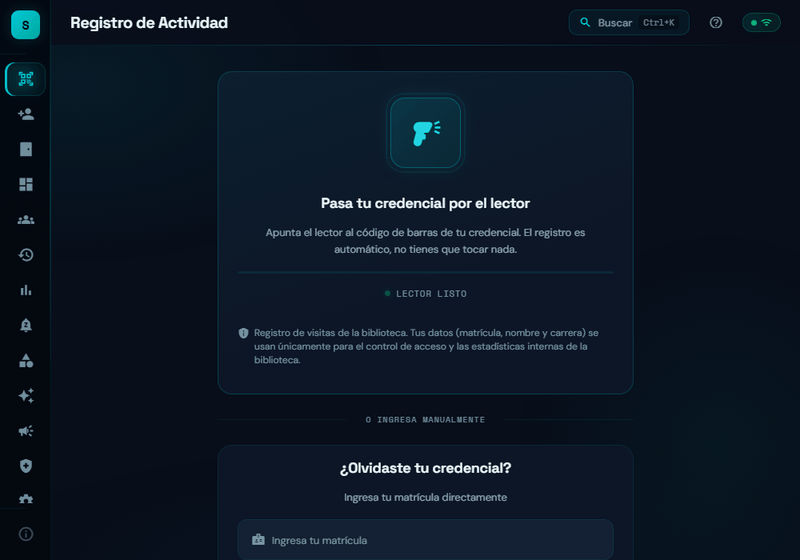
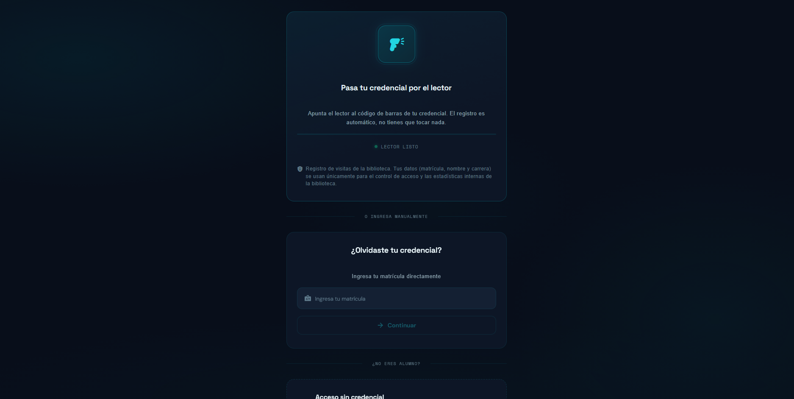
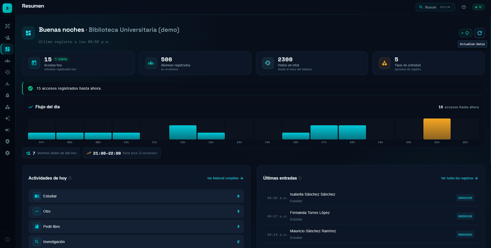
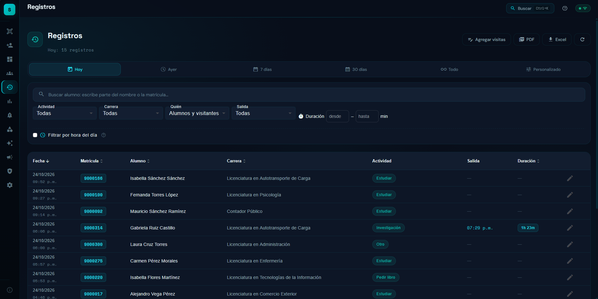
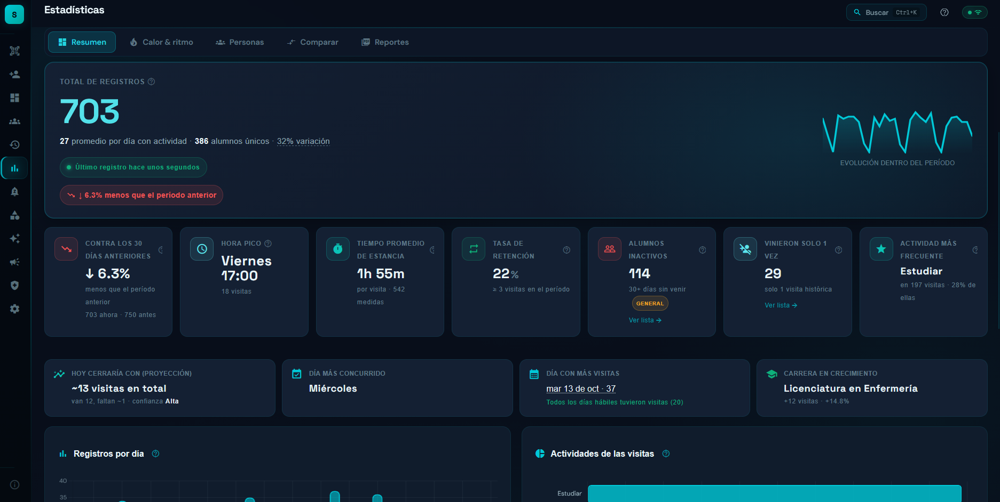
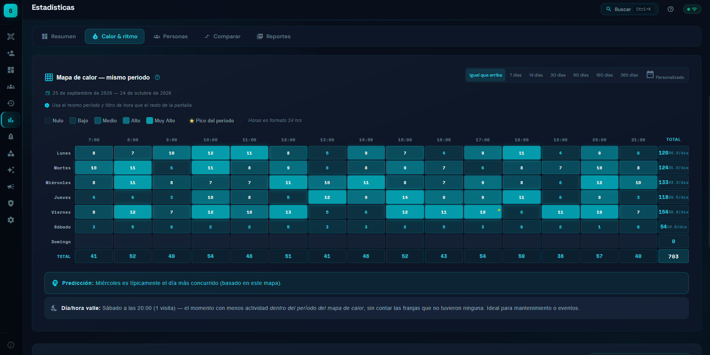

# Stenbrary

Sistema de control de acceso y registro de visitas para bibliotecas
universitarias. En la entrada, el personal lee la credencial del alumno con un
lector de códigos USB (o con la cámara, como respaldo), el alumno elige el
motivo de su visita y el sistema guarda el registro. Con esos datos genera
estadísticas, reportes en PDF y Excel, y constancias de asistencia. Funciona
sin conexión a internet.

**Demo en vivo:** <https://stenbrary.pages.dev> — en la primera pantalla,
"Explorar con datos de ejemplo" carga alumnos y visitas ficticios para ver
estadísticas y reportes sin configurar nada.



## Para quién es y en qué estado está

**Público objetivo:** coordinación y personal de bibliotecas que hoy registran
las visitas en papel o en hojas de cálculo y necesitan cifras confiables de uso.

**Estado:** desarrollado y probado (versión 3.62.1). Se diseñó con la
coordinación de una biblioteca universitaria y se validó con ella, pero **no se
adoptó**: las bibliotecas de esa institución registran sus visitas en un
formulario estandarizado de Google Forms, del que salen los reportes oficiales,
y cambiarlo en una sola biblioteca rompería ese estándar. Se mantiene como
proyecto de portafolio; no está en operación ni tiene usuarios reales. De esa
experiencia salió una herramienta más pequeña que **complementa** el formulario
en lugar de reemplazarlo.

**Autoría:** proyecto individual. Diseño, desarrollo, pruebas, documentación y despliegue.
Desarrollado con apoyo de Claude Code como asistente de programación; las
decisiones de diseño y su verificación son propias.

**Sobre la demo:** es una aplicación web estática; cada navegador
guarda sus propios datos y la primera visita abre un asistente de
configuración. La versión actual almacena los registros localmente
y tiene Supabase desactivado.

## Capturas

**Escáner** — punto de entrada: lectura de la credencial con lector USB o cámara.



**Resumen** — actividad del día.



**Registros** — historial de visitas con filtros.



**Estadísticas** — tendencias, motivos y carreras por período.



**Mapa de calor** — afluencia por día y hora.



## Decisiones técnicas

### 1. Funcionar sin internet por diseño

- **Problema:** la entrada de la biblioteca no puede detenerse porque falle la
  red de la universidad.
- **Decisión:** PWA con IndexedDB como única fuente de verdad, detrás de un solo
  servicio de acceso (`DatabaseService`), y un Service Worker que precarga la
  aplicación. El código de una futura conexión con la nube existe, pero exige
  dos condiciones independientes: credenciales incluidas en el build y que cada
  instalación la active explícitamente.
- **Beneficio:** el registro sigue funcionando sin conexión, y publicar un build
  con credenciales no cambia el comportamiento de ninguna instalación existente.

### 2. Fechas correctas en una ciudad fronteriza

- **Problema:** `new Date('AAAA-MM-DD')` se interpreta como medianoche UTC, que
  en México es el día anterior; además, Nuevo Laredo conserva el horario de
  verano y tiene días de 23 y 25 horas.
- **Decisión:** utilidades de fecha local (`parseFechaLocal`, `fechaLocalISO`,
  `desplazarDias`) en lugar de aritmética con milisegundos, y pruebas que
  corren con la zona horaria `America/Matamoros`, que también aplica el cambio
  de horario. Hay casos de prueba específicos para los días de cambio de horario.
- **Beneficio:** los errores de "un día antes", invisibles cuando las pruebas
  corren en UTC, hacen fallar la integración continua.

### 3. Una sola definición por métrica, verificada desde fuera

- **Problema:** una misma cifra (por ejemplo, alumnos inactivos) llegó a
  calcularse distinto en dos pantallas.
- **Decisión:** cada métrica que aparece en más de una pantalla se calcula en
  funciones puras (`estadisticas.utils.ts`) que reciben la fecha actual como
  parámetro. Las definiciones están documentadas, y una suite E2E carga un
  conjunto de datos fijo y compara cada pantalla contra valores calculados a
  mano. La aplicación incluye además una verificación de cifras en Diagnóstico.
- **Beneficio:** los números que se reportan a la coordinación son consistentes
  y cualquier cambio en una definición se detecta.

### 4. Fusión predecible de respaldos entre equipos

- **Problema:** varias computadoras (por ejemplo, la entrada y la oficina)
  trabajan sin conexión y después hay que juntar sus datos.
- **Decisión:** los datos viajan en archivos de respaldo JSON con dos modos.
  *Combinar* aplica la edición más reciente de cada registro, no deja que los
  cambios hechos por el sistema sustituyan a los de una persona y respeta los
  borrados hechos en otro equipo para que no reaparezcan. *Reemplazar* restaura
  el archivo tal cual y, si falla a la mitad, regresa a los datos anteriores.
  Importar dos veces el mismo archivo no duplica nada.
- **Beneficio:** el intercambio entre equipos es repetible y sin pérdidas
  silenciosas. Todos estos casos tienen pruebas unitarias.

### 5. Lector USB como camino principal y cámara como respaldo

- **Problema:** un lector de códigos USB se comporta como un teclado: escribe
  la matrícula y pulsa Enter. Ese Enter podía activar el botón enfocado y
  registrar al alumno anterior.
- **Decisión:** un servicio intercepta las ráfagas del lector en las pantallas
  del flujo y en los diálogos, y decide si la nueva lectura se atiende o espera
  según el tiempo sin interacción. La cámara queda como respaldo: usa
  `BarcodeDetector` nativo con ZXing como alternativa, y aplica preprocesado de
  imagen (enfoque, binarización Otsu, rotación, ampliación) para webcams de
  foco fijo.
- **Beneficio:** el flujo de la entrada tolera filas de alumnos sin registros
  cruzados, y sigue funcionando cuando no hay lector.

## Stack tecnológico

- **Angular 21** (LTS hasta junio de 2027; componentes standalone, signals, `inject()`, control flow `@if`/`@for`) y **TypeScript 5.9**
- **Angular Material** para la interfaz
- **IndexedDB** con `idb` para la persistencia local
- **`@angular/service-worker`** para la PWA instalable y el funcionamiento sin conexión
- **Chart.js** (gráficas), **jsPDF + jspdf-autotable** (PDF), **SheetJS 0.20.3** (Excel; desde el CDN oficial, en `vendor/`)
- **BarcodeDetector** nativo y **ZXing** como alternativa para la cámara
- **Jasmine + Karma** (unitarias), **Playwright** (E2E), **axe-core** (accesibilidad), **fake-indexeddb**
- **ESLint** (angular-eslint), **Husky** (pre-commit) y **GitHub Actions** (CI)
- **Cloudflare Pages** para la demo
- **Supabase** (Auth + Postgres con RLS): preparado en el código y desactivado en la versión actual

## Requisitos e instalación

- Node.js 22 (ver `.nvmrc`) y npm
- Google Chrome (las pruebas unitarias corren en Chrome headless)

```bash
npm ci
npm start        # http://localhost:4200
```

## Comandos

| Comando | Qué hace |
|---|---|
| `npm start` | Servidor de desarrollo con recarga automática |
| `npm run build` | Build de producción en `dist/stenbrary/browser/` |
| `npm run lint` | ESLint (incluye accesibilidad de plantillas); termina sin errores ni avisos |
| `npx tsc --noEmit -p tsconfig.app.json` | Verificación de tipos sin compilar |
| `npm run test:ci` | Pruebas unitarias en Chrome headless, con cobertura |
| `npx playwright install chromium` | Navegador para las pruebas E2E (una sola vez) |
| `npm run e2e` | Pruebas E2E: levantan su propio servidor en el puerto 4300 (`E2E_PORT` para cambiarlo) y comprueban que responde Stenbrary antes de empezar |
| `npm run e2e:produccion` | Tras `npm run build`: el build servido con las cabeceras de `public/_headers`; busca violaciones de la CSP y prueba el modo sin conexión |
| `npm run check:version` | Verifica que `package.json` y el historial de versiones coincidan |

## Estructura del repositorio

```
src/app/
  core/
    auth/        Supabase, guards por rol y matriz de permisos (Fase 2, desactivada)
    constants/   valores de fábrica de los catálogos
    data/        historial de versiones y contenido estático
    guards/      protección del flujo de registro y acceso por rol
    models/      Alumno, Registro, Motivo, Bitácora
    services/    acceso a IndexedDB, respaldos, reportes, aforo, lector, PIN…
    utils/       lógica pura y probada: fechas, métricas, matrícula, calendario…
  features/      una carpeta por pantalla, todas con carga diferida
  shared/        diálogos y componentes reutilizables
e2e/             pruebas Playwright y fixtures generados por script
supabase/        migraciones SQL (Fase 2)
scripts/         guardrail de versión y utilidades
docs/            seguridad, auditoría de métricas, roadmap, despliegue, pruebas manuales y piloto
vendor/          SheetJS 0.20.3 (ver vendor/README.md)
```

## Arquitectura y persistencia

- **IndexedDB** guarda cuatro colecciones: alumnos, registros, motivos y una
  bitácora de acciones administrativas. Todo acceso pasa por `DatabaseService`.
- **Flujo principal:** escáner → búsqueda por matrícula → (alumno nuevo:
  formulario) → selección de motivo → registro. Si el control de salida está
  activo, una segunda lectura ofrece registrar la salida.
- **Entre equipos**, los datos se intercambian con archivos de respaldo JSON
  (combinar o reemplazar). No hay sincronización en tiempo real.
- **Acciones irreversibles** (borrar por fechas, reemplazar datos, restablecer)
  piden el PIN del coordinador.
- **Supabase** está desactivado: el build de producción no incluye
  credenciales y la conexión requiere además activarla en cada instalación.

## Pruebas

- **483 pruebas unitarias** en 29 archivos (cobertura de sentencias 80 %),
  centradas en la lógica pura (fechas, métricas, matrícula, calendario,
  importación, respaldos, hash del PIN) y en los servicios de datos. Incluyen
  fallos reales a media transacción y PDF generados con texto hostil.
- **85 pruebas E2E** con Playwright: 50 del flujo y las pantallas principales,
  8 de diseño responsive, 23 de cuadre de cifras contra valores calculados a
  mano y 4 de accesibilidad con axe (WCAG 2.1 AA, escritorio y móvil).
- **5 pruebas contra el build de producción** con sus cabeceras de seguridad:
  CSP sin violaciones en todo el recorrido y service worker sin conexión.
- **CI** (GitHub Actions) ejecuta lint, verificación de tipos, pruebas
  unitarias con la zona horaria `America/Matamoros`, build de producción, E2E
  y las pruebas del build con cabeceras.
- El pre-commit verifica la versión, los tipos y los errores de lint.

## Seguridad

Cabeceras con Content-Security-Policy estricta (`script-src 'self'`, sin
`eval`), PIN guardado con PBKDF2, validación completa de respaldos y del
padrón antes de tocar los datos, "Reemplazar" atómico y 0 vulnerabilidades
conocidas en `npm audit`. Detalle, verificación y límites de una app local
sin servidor: [`docs/SEGURIDAD.md`](docs/SEGURIDAD.md).

## Limitaciones conocidas

- Sin servidor: los datos viven en cada navegador y el respaldo es manual.
- El intercambio entre equipos es por archivo, no en tiempo real.
- La cámara solo lee códigos **Code 128** y **Code 39**; no lee QR. Se
  recomienda un lector USB.
- Las tipografías se cargan desde Google Fonts y el Service Worker no las
  incluye en su caché; sin conexión, el navegador podría mostrar fuentes del
  sistema en su lugar.
- El PIN del coordinador protege el modo quiosco del uso casual; no es un
  control de acceso frente a quien controla el equipo (ver `docs/SEGURIDAD.md`).
- No se ha usado en una biblioteca real. El piloto que se había definido
  (`docs/PRUEBA-PILOTO-BIBLIOTECA.md`) queda como referencia.
- Deuda registrada: algunos componentes grandes, como el escáner y las
  estadísticas.

## Estado y próximos pasos

- **Fase 1** (PWA offline-first): terminada. La versión 3.62.1 es la versión
  estable; la 4.0 estaba reservada para la entrega a la biblioteca, que no se
  realizó.
- El proyecto está en **mantenimiento**: correcciones de errores y mejoras
  puntuales.
- Lo que estaba planeado y no se desarrolló (autenticación por roles y
  sincronización con Supabase, préstamos de libros, configuración por
  institución) está documentado en `docs/ROADMAP.md`.

**Lección principal:** antes de construir, entender el proceso institucional
en el que tiene que encajar el sistema. Un sistema completo que no encaja en el
proceso existente no se adopta.

## Licencia y propiedad intelectual

Software propietario. © 2026 Dalton Akenaton Gómez Arellano. Todos los derechos
reservados; ver [`LICENSE`](LICENSE). Las dependencias de terceros se rigen por
sus propias licencias.
